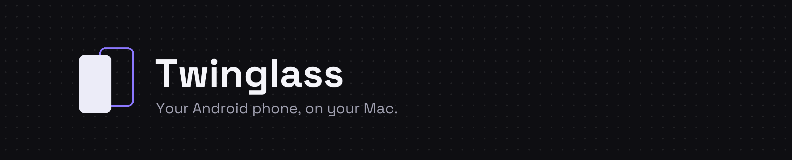
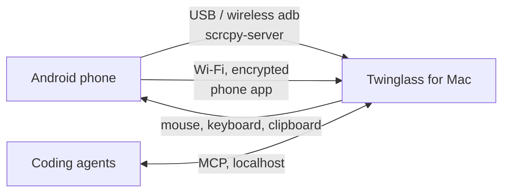

<p align="center">
  
</p>

<p align="center">
  <a href="https://github.com/TrendySloth1001/TwinGlass/releases/latest"></a>
  
  
  
  
</p>

Twinglass puts your Android phone on your Mac ([twinglass.vercel.app](https://twinglass.vercel.app)). You can mirror it, use it with your mouse and keyboard, open a second screen of it next to the real one, and let coding agents test apps on it.

I built it because I spend most of my day on a Mac with an Android phone next to me, and I wanted the phone to feel like part of the desktop instead of something I keep picking up. It runs over USB, wireless debugging, or plain Wi-Fi with no developer options at all.

<p align="center">
  
</p>

## Install

```bash
curl -fsSL https://raw.githubusercontent.com/TrendySloth1001/TwinGlass/master/install.sh | bash
```

or with Homebrew:

```bash
brew tap TrendySloth1001/tap && brew trust TrendySloth1001/tap
brew install --cask twinglass
```

Apple Silicon and macOS 13 or newer. After that, Twinglass updates itself, and it keeps the phone app up to date too.

## Connecting a phone

There are two ways, and you can switch later.

- **Wi-Fi, no setup.** Click **Add phone** on the Mac and scan the QR with your phone. It downloads the phone app straight from your Mac, pairs, and you tap **Mirror to Mac**. No developer options needed.
- **Developer mode.** Turn on USB debugging, install adb (`brew install android-platform-tools`) and plug in. This unlocks everything: second screens, full multi-touch, unlocking with your PIN, and all the agent tools.

## What it does

- Mirrors with hardware decoding (H.265 or H.264) at low latency, around 12 ms on the Mac side.
- Turns your mouse and keyboard into touch and keys. Clipboard sync, drag and drop files, screenshots and recordings.
- Opens a **second screen** of the same phone in its own window, so you can test one app while using another.
- Unlocks with a saved PIN, behind Touch ID.
- ⌘K to open any phone app, send a link, or paste from clipboard history.
- A menu bar icon with every phone and its battery.

The phone app shows what's connected and the phone's details, sends files and text to the Mac from any share sheet, and lets agents read the screen.

## For coding agents

Twinglass includes an MCP server for Claude Code, Cursor, VS Code and others, with 45 tools: screenshots, element trees, taps and typing, installing and launching apps, logcat, crash reports and performance numbers. Agents work on their own second screen of the phone, so you can keep using it while they do.

It's off by default and only listens on your Mac. Setup is in [docs/AGENTS.md](docs/AGENTS.md).

## Privacy

There are no accounts and no analytics. Everything stays between your phone and your Mac. The Wi-Fi link is encrypted (AES-256-GCM, paired with a 6-digit code), and the only thing Twinglass fetches from the internet is the update check.

## How it works

The Mac app speaks the [scrcpy](https://github.com/Genymobile/scrcpy) protocol itself over your system adb. In Wi-Fi mode, the phone app captures the screen and sends the same video format over its own encrypted link. Either way, one decoder draws it on the Mac.



There are diagrams and details in [docs/ARCHITECTURE.md](docs/ARCHITECTURE.md), and the verified protocol notes are in [docs/FACTS.md](docs/FACTS.md).

## Building it yourself

```bash
npm install
env -u ELECTRON_RUN_AS_NODE npm run dev
npm test
npm run companion:build   # the phone app
```

Releasing is covered in [docs/RELEASE.md](docs/RELEASE.md).

## Built with

<p>
  
  
  
  
  
  
  
  
  
  
</p>

## Notes

- There's a [changelog](CHANGELOG.md), and both apps show it under Settings → What's new.
- It isn't notarized yet, and it doesn't run on Intel Macs, Windows or Linux.
- I use it daily with a Nothing Phone (3) on Android 17. If something breaks on your phone, please [open an issue](https://github.com/TrendySloth1001/TwinGlass/issues).

Thanks to [scrcpy](https://github.com/Genymobile/scrcpy) by Genymobile, whose server does the heavy lifting in Developer mode. Twinglass isn't affiliated with Google or Genymobile.
