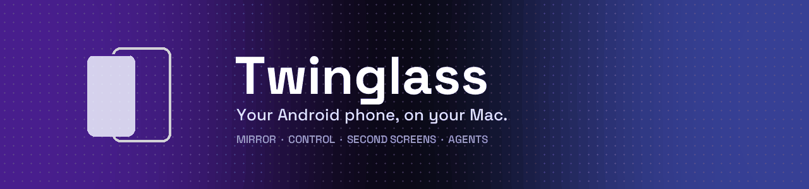
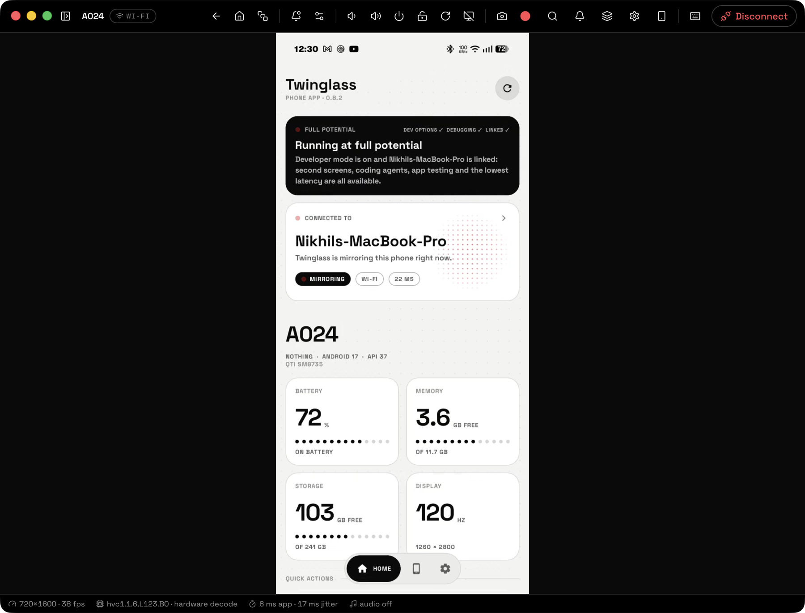
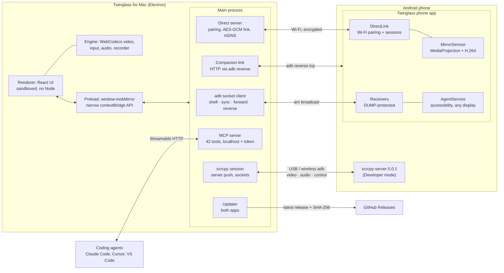
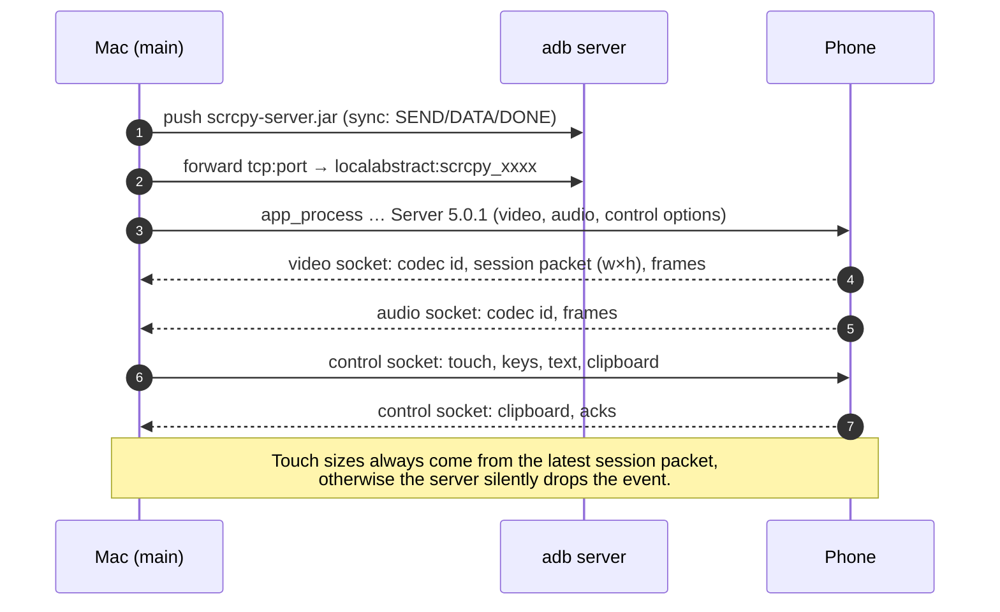
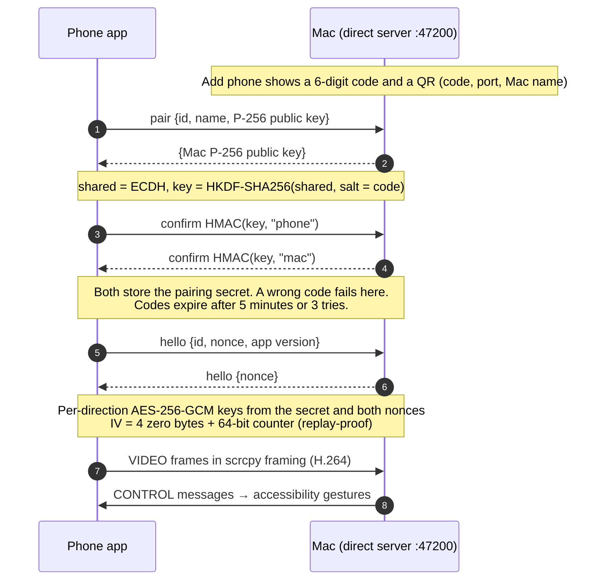
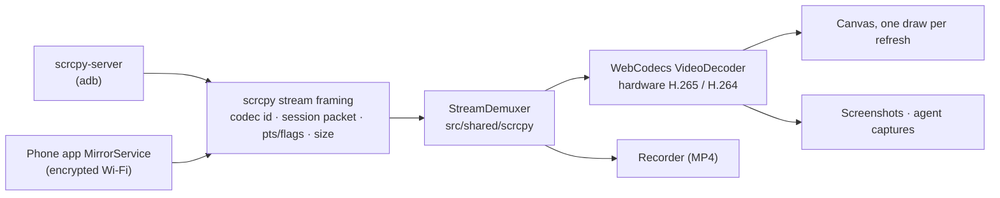
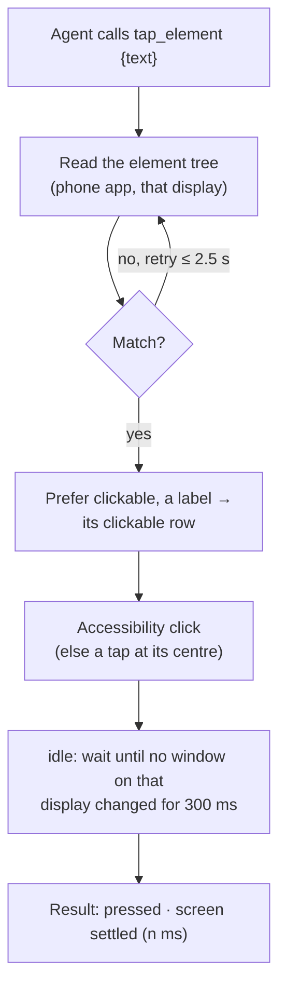
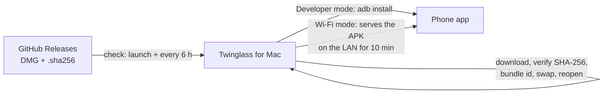
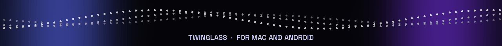

<p align="center">
  
</p>

<p align="center">
  <a href="https://github.com/TrendySloth1001/TwinGlass/releases/latest"></a>
  
  
  
  <a href="https://github.com/TrendySloth1001/TwinGlass/releases"></a>
  <a href="https://github.com/TrendySloth1001/TwinGlass/commits/master"></a>
</p>

<p align="center">
  <b>Mirror it. Control it. Open a second screen of it. Let coding agents test on it.</b><br>
  Over USB, wireless debugging, or plain Wi-Fi with no developer options at all.
</p>

<p align="center">
  <a href="#install">Install</a> ·
  <a href="#what-it-does">Features</a> ·
  <a href="#system-design">System design</a> ·
  <a href="#for-coding-agents-mcp">MCP for agents</a> ·
  <a href="CHANGELOG.md">Changelog</a>
</p>

<p align="center">
  
</p>

---

## Contents

- [Two apps, one product](#two-apps-one-product)
- [Two ways to connect](#two-ways-to-connect)
- [What it does](#what-it-does)
- [For coding agents (MCP)](#for-coding-agents-mcp)
- [System design](#system-design)
- [Measured, not guessed](#measured-not-guessed)
- [Security and privacy](#security-and-privacy)
- [Install](#install) · [Updating](#updating)
- [Build from source](#build-from-source)
- [Tech stack](#tech-stack)
- [Changelog](#changelog) · [Status](#status) · [Credits](#credits)

---

## Two apps, one product

| | **Twinglass for Mac** (this repo's root) | **Twinglass phone app** ([`companion/`](companion/)) |
|---|---|---|
| Built with | Electron 45 · React 19 · TypeScript · Tailwind 4 · shadcn/ui | Kotlin · Jetpack Compose · Material 3 |
| Runs on | macOS 13+, Apple Silicon | Android 10+ (API 29+) |
| Role | Shows and controls the phone, second screens, MCP server for agents, updates both apps | Links to the Mac, Wi-Fi mirroring without developer mode, device details, Share to Mac, element access for agents |

The Mac app works on its own over adb: it pushes the official [scrcpy](https://github.com/Genymobile/scrcpy) server and speaks its protocol directly. The phone app adds what adb can't: mirroring without developer mode, real app icons, rich device details, sharing from any app, and reading and pressing UI elements on any display.

## Two ways to connect

| | **Wi-Fi, no setup** | **Full control (Developer mode)** |
|---|---|---|
| Phone needs | The Twinglass phone app | USB debugging (once), optionally wireless debugging |
| Pairing | Scan a QR on the Mac (or pick the Mac and type a 6-digit code) | Tap "Allow" on the phone's USB debugging prompt |
| Mirroring | Android screen capture → H.264, encrypted over your Wi-Fi | scrcpy-server over adb (USB or wireless debugging) |
| Control | Taps, swipes, Back/Home/Recents, typing (via accessibility) | Full multi-touch, keyboard, clipboard, everything scrcpy can do |
| Second screens & agent screen | — | ✓ |
| Coding agents (MCP), app-testing tools | Basic | ✓ all 42 tools |
| Unlock with saved PIN | — | ✓ |

The phone app's Home always shows which one you're in: **Running at full potential** (Developer mode on and linked), **Almost at full potential** (debugging on, not linked yet), or **Wi-Fi mode** with a one-tap way up.

---

## What it does

### Mirror and control
- **Hardware-decoded video** (H.265 when the phone and Mac both support it, H.264 otherwise) through WebCodecs, drawn once per display refresh.
- **Mouse and keyboard as touch and keys**: right-click = Back, middle-click = Home, wheel = scroll, shortcuts for volume, power, rotate, notifications and quick settings; typing goes straight to the phone, non-ASCII through the clipboard.
- **Clipboard sync** both ways, **drag & drop** files onto the mirror (APKs install, everything else lands in a phone folder you choose), **screenshots** and **recordings** to `~/Pictures/Twinglass` and `~/Movies/Twinglass`.
- **Rotation that sticks** (handles auto-rotate correctly), **screen off while mirroring**, **audio** to the Mac or both.
- **Unlock with your saved PIN**, including Nothing's under-display-fingerprint bouncer and apps that use Android's biometric prompt; Touch ID on the Mac is optional for you and always required for agents.
- **Compact phone-shaped window** with a control rail, phone frames (3 styles × 7 finishes), optional nav bar, always-on-top; or a **full view** with sidebar and status bar.

### Second screens
Open a **second, independent screen of the same phone** in its own Mac window, e.g. WhatsApp on the physical phone while you test another app on the Mac. Each one is a real virtual display (scrcpy `new_display`) with Twinglass's own home screen (app grid with real icons), an app switcher, and keyboard input that stays on that screen. Size: phone, tablet or landscape.

### On the Mac
- **⌘K command palette**: open any phone app by name, send a link (opens on the phone) or text, clipboard history (memory only, skips password-manager copies).
- **Menu bar icon** with every phone, its battery and one-click mirroring; launch at login; tile all mirror windows.
- **Phone details** window: SoC, Android build and API level, memory, storage, display, battery health and cycles, cameras, sensors, codecs, network, features. Filterable, click to copy.
- **Settings** with Advanced, About and What's new pages.

### On the phone
- **Home** that says where you stand, **device details** in 12 groups, **Share to Mac** from any app's share sheet, **QR pairing**, **two-way forget**, and updates delivered by the Mac (the phone app never goes online for them). More in the [phone app README](companion/README.md).

---

## For coding agents (MCP)

A local MCP server (off by default, localhost only, bearer token) gives Claude Code, Cursor, VS Code and other MCP clients **42 tools**. By default agents work on **their own second screen** of the phone, in a window you can watch, so you keep using the phone.

| Group | Tools |
|---|---|
| See | `screenshot`, `get_ui_tree`, `find_elements`, **`screen_map`** (every view in dp: position, size, insets, gaps, layout params, text size in sp, colours, plus an annotated image) |
| Act | `tap_element`, `set_text`, `wait_for`, `tap`, `long_press`, `swipe`, `scroll`, `type_text`, `press_key`, `run_steps` (up to 50 actions per call) |
| Apps | `list_apps`, `launch_app` (by name), `open_url` (incl. deep links), `stop_app` |
| App testing | `install_apk`, `app_info`, `start_activity` (with cold-start time), `clear_app_data`, `uninstall_app`, `set_permission`, `get_crashes`, `logcat`, `app_performance` (jank %, frame-time percentiles, memory, CPU) |
| Conditions | `set_device_state` (dark mode, font scale, animations, density, Wi-Fi, mobile data, airplane, fake battery; `reset` restores everything) |
| Device | `device_info`, `phone_details`, `get_notifications`, `push_file`, `pull_file`, `list_files`, `reverse_port`, `record_screen`, `set_clipboard`, `unlock_phone` (Touch ID), `shell` (opt-in), `agent_screen` |

**Built for reliability.** Every action returns only once the screen has settled; element lookups retry while menus open; a label presses the row around it; `set_text` reads the field back and never reports a change that didn't happen; `scroll` says whether anything moved. Every group can be switched off in Settings → Agents. Setup and details: [docs/AGENTS.md](docs/AGENTS.md).

---

## System design

### Architecture



### Developer mode: one tunnel, three sockets



### Wi-Fi, no setup: pairing and an encrypted session



### One video pipeline for both modes



### How an agent action runs



### Updates for both apps



The phone app never contacts the internet: every Mac release carries the newest phone app and its version code.

### Repository layout

```
src/shared/scrcpy/      protocol: control encoders, stream demuxer (no Node/DOM; runs in both processes)
src/main/adb/           system adb: socket client (shell/sync/forward/reverse), parsers, limiter
src/main/scrcpy/        session lifecycle: push server, sockets, options
src/main/direct/        Wi-Fi, no setup: pairing, encrypted link, mDNS, sessions
src/main/agent/         MCP server and the device controller behind it
src/preload/            the narrow window.mobMirror API (renderer stays sandboxed)
src/renderer/src/       React UI; engine/ (WebCodecs video, input, audio, recorder) is framework-free
companion/              the Android phone app
changelog/              release notes shown in both apps and rendered to CHANGELOG.md
docs/                   FACTS (verified protocol/platform facts), DECISIONS (ADRs), REQUIREMENTS, AGENTS, RELEASE
```

Design decisions are recorded as ADRs in [docs/DECISIONS.md](docs/DECISIONS.md); every byte layout is verified against the scrcpy 5.0.1 source in [docs/FACTS.md](docs/FACTS.md).

---

## Measured, not guessed

Numbers from the test phone (Nothing Phone (3), Android 17) and an Apple Silicon Mac; methods and raw tables in [docs/FACTS.md](docs/FACTS.md).

| What | Result |
|---|---|
| Mac pipeline, packet → drawn | ~12 ms (decode ~3.5 ms) |
| USB, 1920 px / 12 Mbps (default "High") | +16 ms typical, +33 ms worst 5 % (native resolution: +50 / +74 ms, the phone's encoder, not the cable) |
| Wi-Fi debugging, 1600 px | +12–14 ms typical, +23–27 ms worst 5 % |
| Background `adb` processes while mirroring | 0 (commands go over the adb server's socket; was ~20 per 30 s) |
| Agent screenshot round trip | ~57 ms |
| Phone app size | 2.9 MB (release build) |

---

## Security and privacy

- **Wi-Fi link**: P-256 key exchange confirmed by the 6-digit code (wrong code fails; codes expire after 5 minutes or 3 tries), then **AES-256-GCM on every frame** with per-direction keys and replay protection. Byte-identical test vectors on both sides.
- **Forgetting is two-way**: forget on the Mac or the phone and the other side forgets too, immediately when connected, otherwise on the next connection.
- **Phone app receivers** the Mac talks to over adb require the `DUMP` permission, which only the adb shell has; other apps on the phone can't use them. What the Mac may use can be switched off on the phone.
- **Agent access** is off by default, binds to `127.0.0.1`, validates Host/Origin and needs a 256-bit token stored with mode 600; the renderer never sees it. Agents can't unlock without your Touch ID.
- **Updates are verified**: the Mac checks each download's SHA-256 and bundle id before swapping itself, and keeps the old app if the copy fails.
- **Nothing leaves your network.** No accounts, no telemetry, no cloud. The only internet request is the update check against GitHub Releases.

---

## Install

Apple Silicon, macOS 13 or newer. From the terminal:

```bash
curl -fsSL https://raw.githubusercontent.com/TrendySloth1001/TwinGlass/master/install.sh | bash
```

It downloads the latest release, checks its SHA-256, installs Twinglass into /Applications (quitting an older copy first) and offers to install adb for Developer mode. Files fetched by `curl` aren't quarantined, so the app opens straight away even though it isn't notarized yet. Add `--open` to launch it, `--no-adb` to skip adb, and `--uninstall` (with `--purge` for settings) to remove it.

Or with Homebrew (Homebrew 7 asks you to trust a third-party tap once):

```bash
brew tap TrendySloth1001/tap && brew trust TrendySloth1001/tap
brew install --cask twinglass
```

Downloaded the DMG in a browser instead? macOS may refuse to open it the first time; clear the quarantine once with `xattr -cr /Applications/Twinglass.app`.

Then pick a way to connect:

- **Wi-Fi, no setup**: on the Mac, **Add phone**. Scan the QR with the phone's camera to download the phone app straight from your Mac, open it, choose *Wi-Fi, no setup → Pair with your Mac → Scan QR code*, then tap **Mirror to Mac**.
- **Developer mode**: install adb (`brew install android-platform-tools`; Twinglass uses your system adb and never bundles Google's), enable USB debugging, plug in and tap Allow. Wireless debugging pairing (code or QR) is in the Add phone sheet.

### Updating

- **Twinglass for Mac updates itself.** It checks GitHub Releases shortly after launch and every 6 hours; when there's a new version it offers **Update**, downloads the DMG, verifies its SHA-256, swaps the app in place and reopens. Settings → About → Check now checks any time. Homebrew knows the app updates itself (`auto_updates`).
- **The phone app updates from your Mac**; it never goes online for it.
  - *Developer mode*: the Mac offers **Update** when a connected phone has an older phone app (installed over adb, settings kept); the phone's Home can ask for it too.
  - *Wi-Fi, no setup*: the phone's Home shows *Update available*; **Update** downloads it from the Mac over your Wi-Fi, then tap Install.

---

## Build from source

```bash
npm install                   # also downloads scrcpy-server 5.0.1 and checks its SHA-256
env -u ELECTRON_RUN_AS_NODE npm run dev        # hot reload; dev:debug also exposes CDP on 9333
npm test                      # unit tests (vitest)
MOB_DEVICE=<serial> npm test  # plus real-device integration tests
npm run typecheck             # TypeScript 7 (tsc), Vite does the transpiling
npm run dist:mac              # DMG in dist/
npm run release               # phone app + CHANGELOG.md + DMG (with the phone app inside) + Homebrew cask
npm run companion:build       # phone app (release APK)
npm run companion:install     # build + adb install
```

From a VS Code terminal keep the `env -u ELECTRON_RUN_AS_NODE` prefix: the extension host sets it and Electron would start as plain Node. Releasing: [docs/RELEASE.md](docs/RELEASE.md).

---

## Tech stack

<p align="center">
  <br>
  
</p>

<p align="center">
  
  
  
  
  
  
  
</p>

| Layer | Mac | Phone |
|---|---|---|
| Language | TypeScript (TS 7 for checking) | Kotlin |
| UI | React 19, Tailwind 4, shadcn/ui, Lucide | Jetpack Compose, Material 3 |
| Video | WebCodecs (hardware decode), canvas | MediaProjection, MediaCodec (hardware H.264) |
| Device access | System adb over its server socket; scrcpy-server 5.0.1 | AccessibilityService, NsdManager (mDNS), Google code scanner |
| Crypto | Node crypto: P-256, HKDF, HMAC, AES-256-GCM | javax.crypto with the same test vectors |
| Agents | MCP TypeScript SDK (Streamable HTTP) | Accessibility trees and actions on any display |
| Build & ship | electron-vite, electron-builder, Vitest, Homebrew cask, install.sh | Gradle, R8 |

---

## Changelog

Every release of both apps is in [CHANGELOG.md](CHANGELOG.md), also shown in each app (Settings → What's new on both). Releases: [github.com/TrendySloth1001/TwinGlass/releases](https://github.com/TrendySloth1001/TwinGlass/releases).

## Status

Working and used daily on a Nothing Phone (3) with Android 17. Not yet: notarized releases, Intel Macs, Windows/Linux, live drag feedback in Wi-Fi mode (gestures are sent when the finger lifts). The product name is Twinglass; internal identifiers keep the original `mob-mirror` name so saved settings carry over.

## Credits

- [scrcpy](https://github.com/Genymobile/scrcpy) by Genymobile (Apache-2.0): the phone-side server Twinglass pushes in Developer mode.
- [Space Grotesk](https://github.com/floriankarsten/space-grotesk), Space Mono and Doto (SIL OFL 1.1): typefaces.
- UI components from [shadcn/ui](https://ui.shadcn.com) and icons from [Lucide](https://lucide.dev); tech icons by [skillicons.dev](https://skillicons.dev) and [Shields.io](https://shields.io).
- The banner animations and screenshot are original to this project.

Twinglass is not affiliated with Google or Genymobile. Android is a trademark of Google LLC.

<p align="center">
  
</p>
