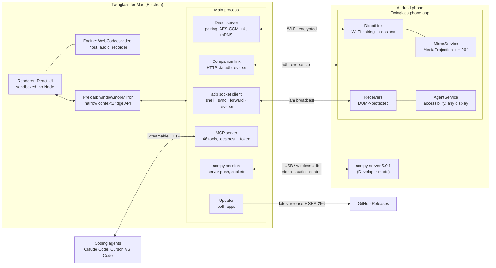
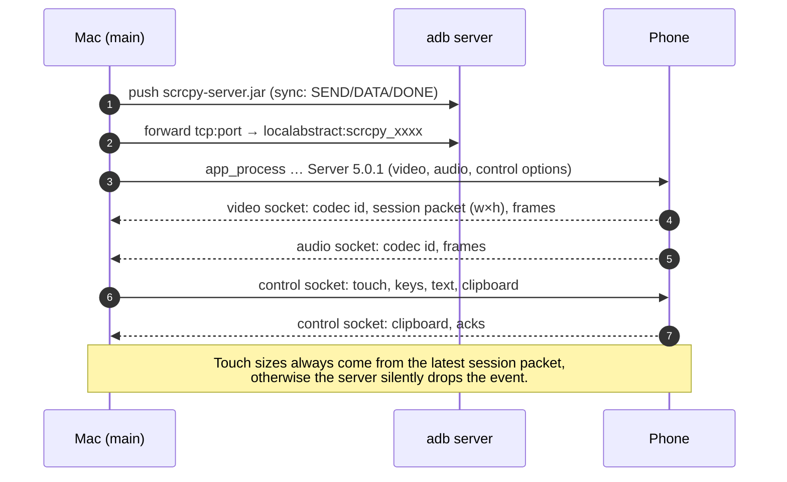
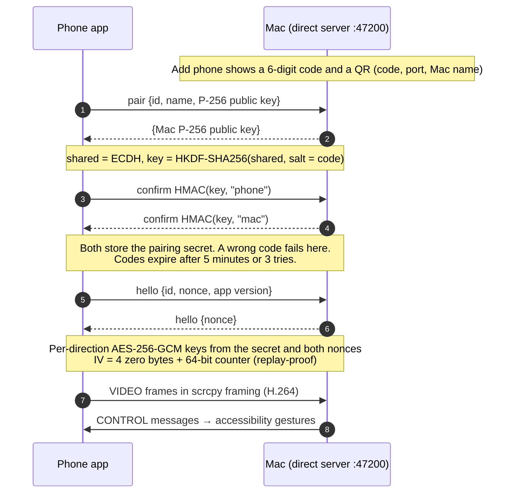
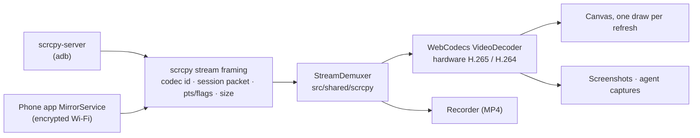
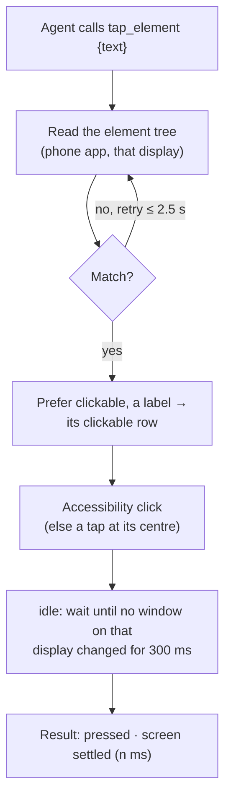
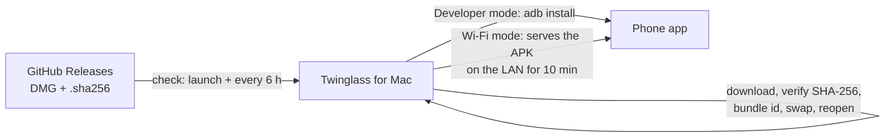

# Architecture

How Twinglass is put together. The README has the short version; this is the long one.

## Overview



## Developer mode: one tunnel, three sockets



## Wi-Fi, no setup: pairing and an encrypted session



## One video pipeline for both modes



## How an agent action runs



## Updates for both apps



The phone app never contacts the internet: every Mac release carries the newest phone app and its version code.

## Repository layout

```
src/shared/scrcpy/      protocol: control encoders, stream demuxer (no Node/DOM; runs in both processes)
src/main/adb/           system adb: socket client (shell/sync/forward/reverse), parsers, limiter
src/main/scrcpy/        session lifecycle: push server, sockets, options
src/main/direct/        Wi-Fi, no setup: pairing, encrypted link, mDNS, sessions
src/main/agent/         MCP server and the device controller behind it
src/preload/            the narrow window.mobMirror API (renderer stays sandboxed)
src/renderer/src/       React UI; engine/ (WebCodecs video, input, audio, recorder) is framework-free
companion/              the Android phone app
changelog/              release notes shown in both apps and rendered to CHANGELOG.md
docs/                   FACTS (verified protocol/platform facts), DECISIONS (ADRs), REQUIREMENTS, AGENTS, RELEASE
```

Design decisions are recorded as ADRs in [docs/DECISIONS.md](docs/DECISIONS.md); every byte layout is verified against the scrcpy 5.0.1 source in [docs/FACTS.md](docs/FACTS.md).
